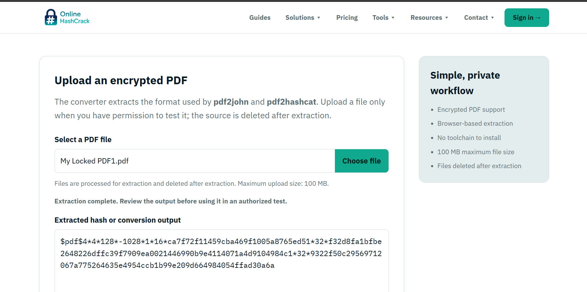
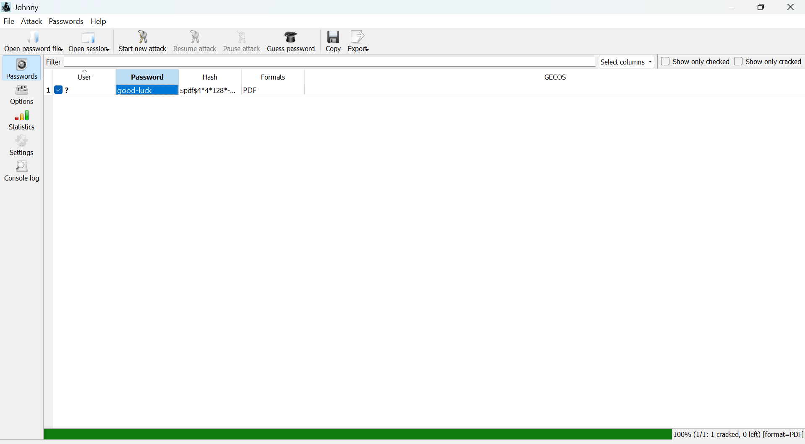
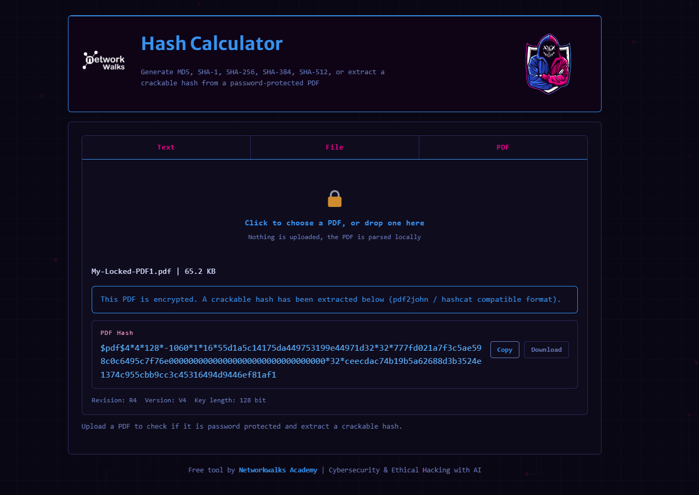
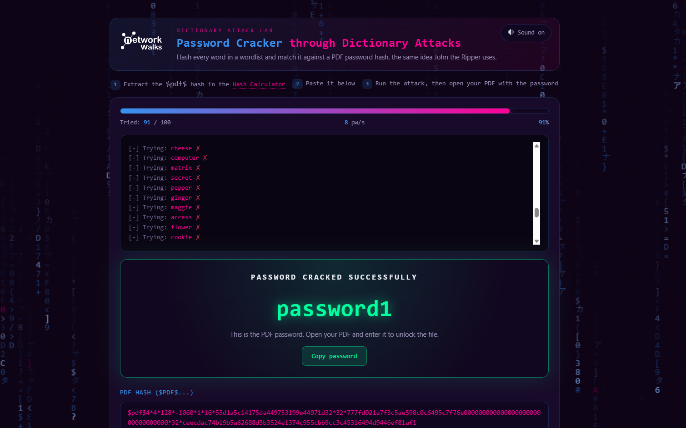

# Penetration Testing Report: Password Cracking with JTR & Networkwalks Tools

| Parameter | Details |
| :--- | :--- |
| **Program/Batch** | B048B |
| **Date** | 16 November 2026 |
| **Modules Completed** | W3-PM1 (Password Cracking with JTR), W3-PM2 (Password Cracking with NW Tools) |
| **Client / Target** | Educational Lab / Protected PDF File (`My Locked PDF1.pdf`) |
| **Permission Secured?** | Yes (Authorized Educational Environment) |
| **Phases Covered** | Password Cracking & Hash Analysis |

---

## 1. Liability Disclaimer
I have performed these activities only on systems and devices where I had secured written permission or on files provided for authorized educational and research purposes. All materials are for learning how to secure systems against unauthorized access. Misuse of these tools and techniques can lead to severe legal consequences.

---

## 2. Introduction
This report covers Week 3 of my Cybersecurity & Ethical Hacking internship program at Networkwalks. The focus of this module is password security, hash extraction, and dictionary-based password cracking. 

I practiced recovering passwords from an encrypted PDF file (`My Locked PDF1.pdf`) using two different approaches:
1. **John the Ripper (JTR) & Johnny GUI** (W3-PM1)
2. **Networkwalks Browser-Based Hash Calculator & Password Cracker Tools** (W3-PM2)

---

## 3. Tools Used

| Tool | Purpose |
| :--- | :--- |
| **John the Ripper (CLI & Johnny GUI)** | Industry-standard password cracking tool used to test password strength against hashed values. |
| **Networkwalks Hash Calculator** | Web-based utility used to parse encrypted files and extract crackable hashes (e.g., `$pdf$`). |
| **Networkwalks Password Cracker** | Web-based dictionary attack tool simulating automated wordlist cracking. |
| **Adobe Acrobat Reader** | PDF viewer used to verify the recovered password against the encrypted file. |

---

## 4. Activities Performed

### 4.1 Password Cracking with John the Ripper (W3-PM1)
* **Hash Extraction:** Extracted the secure hash from the encrypted PDF using standard hash extraction workflows (`pdf2john`).
* **Tool Configuration:** Configured the Johnny GUI frontend to link with the backend `john.exe` executable from the JTR Jumbo package.
* **Cracking Execution:** Loaded the hash file (`hash1.txt`) into Johnny and initiated a dictionary attack. Successfully recovered the plaintext password (`password1`).

### 4.2 Password Cracking with Networkwalks Tools (W3-PM2)
* **Hash Calculation:** Uploaded `My Locked PDF1.pdf` to the Networkwalks browser-based Hash Calculator.
* **Hash Extraction:** Generated and copied the complete `$pdf$` crackable hash format.
* **Dictionary Attack:** Pasted the hash into the Networkwalks Password Cracker, ran the built-in wordlist dictionary attack, and successfully matched the plaintext password (`password1`).
* **Verification:** Unlocked `My Locked PDF1.pdf` using the recovered password to reveal the completion flag.

---

## 5. Key Takeaways & Security Implications
* **Hashing vs. Encryption:** Hashing is a one-way mathematical function used to verify data integrity, whereas encryption is two-way and reversible with the correct key. Password crackers target hashes because passwords are never stored in plaintext.
* **Password Strength:** Weak, common dictionary words (such as `password1`) can be cracked in seconds using automated wordlists. Enforcing long, complex passphrases significantly increases the computational time required for a successful cracking attack.

---

## 6. Evidences Collected

### 6.1 JTR Hash Extraction

### 6.2 Johnny Tool Cracking Success

### 6.3 Networkwalks Hash Calculator Output

### 6.4 Networkwalks Password Cracker Success

### 6.5 Unlocked PDF Flag Verification

---

### 👤 Author
**Irfan Mohamed**  
Cybersecurity Professional 
